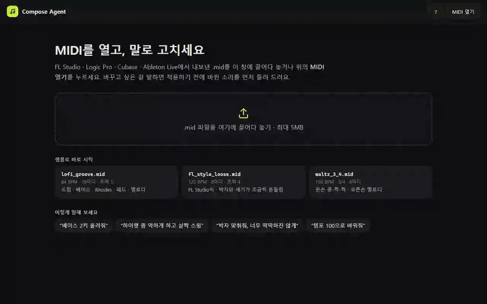

# Compose Agent

**MIDI를 열고, 말로 고치는 작곡 도우미.** "하이햇 좀 약하게 하고 살짝 스윙 넣어줘"라고 하면 LLM 에이전트가 편집 도구를 골라 실행하고, 적용하기 전에 **바뀐 소리와 원래 소리를 번갈아 들려** 준다. FL Studio · Logic · Cubase · Ableton에서 내보낸 `.mid`를 그대로 쓰고, 고친 결과는 다시 `.mid`나 음원으로 내보낸다.



> 현재 **v0.1** (MIDI를 말로 편집) 완료. 다음은 v0.2 화성 분석 · 리하모니 → v0.3 말로 만들기 → … → v1.0. 계획은 [docs/roadmap.md](docs/roadmap.md), 배포는 v1.0에서 한 번에.

## 한 번의 편집 흐름

1. **말하기** — "9마디부터 패드 약하게 하고 베이스 2키 올려줘", 또는 피아노롤에서 부분을 끌어 고르고 "여기 한 옥타브 올려줘"
2. **에이전트** — 도구를 골라 실행한다(실행 단계가 채팅에 실시간으로 보임). 도구가 오류를 돌려주면 읽고 인자를 고쳐 다시 부른다
3. **미리보기** — 곡은 아직 그대로. 바뀔 음은 라임색, 원래 위치는 점선. **B** 키로 바뀐 소리 ↔ 원래 소리, 구간 반복으로 같은 마디를 계속
4. **적용 · 고치기 · 취소** — 적용하면 히스토리에 남고 언제든 되돌린다. "아니 스윙은 빼줘"처럼 말하면 미리보기를 버리고 다시 한다

## 할 수 있는 것

| 분야 | 기능 |
| --- | --- |
| **말로 편집** (도구 16개) | 조옮김 · 옥타브 · 퀀타이즈 · 세기 · 스윙 · 템포 · 음 지우기 · 음 길이(스타카토 · 레가토) · 마디 복사 · 반복 · 사람이 친 느낌(휴머나이즈) · 점점 세게/여리게 · 트랙 볼륨 · 팬 · 악기 · 드럼 킷 · 드럼 소리 하나씩 바꾸기 · 트랙 복제 · 코드에서 탑노트 · 베이스 라인 뽑기 |
| **화면에서 직접** | 피아노롤 편집(더블클릭 추가 · 끌어 옮기기 · 길이 · 지우기 · 여러 개 고르기 · 격자에 붙이기 · 정박에 맞추기 Q) · 벨로시티 편집 · 드럼 소리별 크기 · 악기 128종 · 드럼 킷 9가지 · 레인별 드럼 소리 40가지 · 볼륨 · 팬 |
| **듣기** | 실제 악기 샘플 재생 · 바뀐 소리/원래 소리 비교 · 구간 반복 · 음소거 · 솔로 · 단축키 17개(? 키로 목록) |
| **기록** | 히스토리(무엇을 · 언제) · 되돌리기 · 새로고침 · 서버 재시작 뒤에도 그대로(SQLite) |
| **내보내기** | MIDI(전체 곡 · 트랙 하나 · 트랙별 .zip) · 음원(WAV · MP3 · FLAC · OGG · M4A · MP4) — 들리는 그대로 |
| **DAW 파일 읽기** | 10번 채널 · 트랙 이름(FPC · Drum Rack …) · 음 패턴으로 드럼을 찾아 Logic Drummer 트랙도 드럼으로 인식 |

새 멜로디 · 드럼 패턴을 **지어내는** 작곡은 아직 하지 않는다(v0.3). 그런 요청에는 흉내 내지 않고 못 한다고 말한 뒤 할 수 있는 것을 제안한다.

## 에이전트 설계

- **계산은 검증된 코드가, LLM은 고르기와 설명만.** 음을 직접 쓰게 하지 않고 도구(Project → 새 Project 순수 함수, 인자는 JSON Schema로 검증)만 부르게 해서 결과를 테스트하고 숫자로 평가할 수 있다.
- **미리보기로만 바꾼다.** 에이전트 편집은 적용 전까지 미리보기에 쌓이고, 사용자가 듣고 정한다. 미리보기를 고치라는 말("아니", "말고")에는 `start_over`로 미리보기를 버리고 처음부터 한다.
- **화면과 대화가 이어진다.** 피아노롤에서 고른 부분이 메시지와 함께 가서 "여기 · 이 부분"이 그 범위를 가리킨다. 화면에서 바꾼 악기 · 볼륨도 히스토리와 대화에 같은 문장으로 남는다.
- **LLM은 바꿔 끼운다.** 기본은 Claude(Anthropic), OpenAI 형식(OpenAI · Ollama · Gemini)도 같은 코드로. 명령마다 같은 도구 설명 · 규칙에 프롬프트 캐시를 걸어 입력의 94~99%를 캐시로 읽는다.

## 평가

정답 있는 명령 70개 + 여러 턴 대화 9개를 실제 모델로 돌려 **도구와 인자가 정답과 맞는지** 채점한다 (`backend/eval/`). 같은 명령을 여러 번 돌려 불안정한 것을 찾는다.

| 모델 | 정답 | 응답 시간 (중앙값) |
| --- | --- | --- |
| **Claude Haiku 5.5** (기본) | **79/79** (4회 모두) | 2.6초 |
| Claude Sonnet 5.5 | 79/79 (2회 모두) | 3.3초 |
| OpenAI gpt-6-luna (이전 기본) | 78/79 | 2.9초 |

평가로 찾아 고친 실수들 — 없는 트랙을 비슷한 트랙으로 짐작하기, "4옥타브"를 되는 값(3)으로 바꿔 버리기, 마디 범위가 다른 편집에 번지기, 새 규칙 한 줄("거절하지 말고")이 다른 분야 행동을 바꾼 회귀, 모든 트랙을 빈 목록으로 보내 아무것도 안 바꾸고 "만들었어요"라고 답하기 — 은 [docs/eval.md](docs/eval.md)에 회차별로 남겼다. 개발 과정의 문제 · 시도 · 결과는 [docs/devlog.md](docs/devlog.md).

## 구조

```
compose-agent/
├── backend/                FastAPI · Python
│   ├── app/
│   │   ├── models/         Project · Track · Note (시간 단위 = 박)
│   │   ├── midi_io/        MIDI ↔ Project 변환 (DAW별 드럼 인식, 한글 트랙 이름)
│   │   ├── tools/          편집 도구 16개 (순수 함수 + 인자 검증 · JSON Schema)
│   │   ├── agent/          에이전트 루프 · 시스템 프롬프트 · LLM 연결(Claude · OpenAI 형식)
│   │   ├── store/          버전 · 미리보기 · 대화 저장 (메모리 + SQLite)
│   │   └── api/            REST · SSE(에이전트 진행 상황) · 음원 변환(ffmpeg)
│   ├── eval/               평가 (명령 · 대화 · 채점 · 결과 기록)
│   └── tests/              pytest 231개
├── frontend/               React · TypeScript · Vite · zustand
│   └── src/
│       ├── audio/          catalog(악기 · 드럼 목록) · engine(늦게 불러오기) · player · instruments(Tone.js) · render(음원)
│       ├── components/     TopBar · TrackList · PianoRoll · Overview · ChatPanel · VersionPanel(히스토리) …
│       ├── store/          project · chat · player
│       └── shortcuts.ts    단축키
├── samples/                시연 · 테스트용 MIDI (코드로 생성)
├── scripts/                샘플 생성
└── docs/                   로드맵 · 평가 · 개발 기록
```

## 실행 방법 (Windows)

필요한 것: Python 3.11 이상, Node.js 20 이상. 선택: [ffmpeg](https://ffmpeg.org/download.html) — PATH에 있으면 음원을 MP3 · FLAC · OGG · M4A · MP4로도 내보낸다(없으면 WAV만).

**1. 백엔드** (터미널 1)

```powershell
cd backend
python -m venv compose_venv
compose_venv\Scripts\activate
pip install -r requirements.txt
copy .env.example .env    # 그다음 .env에 ANTHROPIC_API_KEY 넣기
uvicorn app.main:app --reload --port 8100
```

에이전트는 기본으로 Claude를 쓴다: `backend/.env`에 `ANTHROPIC_API_KEY`, 모델은 `ANTHROPIC_MODEL`(기본 `claude-haiku-5-5`). OpenAI 형식 서버는 `LLM_PROVIDER=openai`와 `OPENAI_API_KEY` · `OPENAI_MODEL` · `OPENAI_BASE_URL`. 키가 없어도 나머지 기능은 동작하고 채팅만 503 `llm_unavailable`을 돌려준다. `.env`를 바꾸면 백엔드를 다시 켠다. API 문서: `http://localhost:8100/docs`

**2. 프론트엔드** (터미널 2)

```powershell
cd frontend
npm install
npm run dev
```

터미널에 나온 주소(보통 `http://localhost:5173`)를 열고 **MIDI 열기**나 처음 화면의 샘플을 누른다. 프로젝트는 `backend/data/compose.db`에 저장된다(공개 저장소에 올라가지 않음).

**테스트 · 평가**

```powershell
cd backend
pytest                                            # 231개
compose_venv\Scripts\python -m eval.run           # 실제 LLM으로 79개 (API 비용 발생)
compose_venv\Scripts\python -m eval.run --models claude-haiku-5-5,claude-sonnet-5-5 --repeat 3
```

## 샘플 MIDI

`samples/`의 파일은 전부 코드로 만든 것이라 저작권 걱정 없이 시연 · 테스트에 쓸 수 있다 (`backend\compose_venv\Scripts\python scripts\make_samples.py`로 다시 만듦).

| 파일 | 내용 |
| --- | --- |
| `lofi_groove.mid` | 84 BPM · 16마디 · 드럼 · 베이스 · Rhodes · 패드 · 멜로디. 메인 데모 |
| `fl_style_loose.mid` | FL Studio식 — 드럼 이름 `FPC`(10번 채널 아님), 악기 번호 전부 0, 박자 · 세기가 흔들림 |
| `waltz_3_4.mid` | 3/4 박자 |
| `tempo_change.mid` | 5마디부터 100 → 130 BPM (첫 템포만 쓰고 안내) |

## DAW에서 MIDI 내보내기

| DAW | 내보내기 |
| --- | --- |
| FL Studio | **File → Export → MIDI file…** |
| Logic Pro | 리전을 고르고 **File → Export → Selection as MIDI File…** |
| Cubase | **File → Export → MIDI File…** |
| Ableton Live | MIDI 클립 우클릭 → **Export MIDI Clip…** (클립마다 하나씩) |

트랙 이름을 붙여 두면 앱에서도 그 이름으로 보인다. 앱에서 내보낸 `.mid`에는 악기 번호 · 볼륨(CC7) · 팬(CC10) · 드럼 킷 번호가 들어간다. 레인별로 고른 드럼 소리는 MIDI 표준에 담을 곳이 없어 이 앱에만 남는다(음원에는 담긴다).

v0.1의 제한: 템포 · 박자 변화가 있으면 첫 값만 쓴다 (화면에 안내가 뜬다).

## API

| 메서드 | 경로 | 설명 |
| --- | --- | --- |
| POST | `/api/v1/projects` | MIDI 업로드 → Project |
| GET | `/api/v1/projects` · `/{id}` · `/{id}/session` | 최근 프로젝트 · 현재 버전 · 다시 열기(미리보기 · 대화 포함) |
| POST | `/api/v1/projects/{id}/chat/stream` | 말로 편집 → 미리보기. 진행 상황을 SSE로 (`/chat`은 한 번에). 화면에서 고른 부분을 `selection`으로 |
| POST | `/api/v1/projects/{id}/preview/apply` · `/cancel` | 미리보기 적용 · 버리기 |
| GET · POST | `/api/v1/projects/{id}/versions` · `/versions/{n}/restore` · `/undo` | 히스토리 · 되돌리기 (지우지 않고 새로 남김) |
| POST | `/api/v1/projects/{id}/tracks/{tid}/notes` · `/velocities` · `/instrument` · `/mix` · `/drum-sound` · `/lane` | 화면에서 직접 편집 (화면이 본 버전과 다르면 409) |
| GET | `/api/v1/projects/{id}/export` (`?track=`) · `/export/tracks` | `.mid` · 트랙 하나 · 트랙별 `.zip` |
| POST | `/api/v1/audio/convert?format=mp3` | 브라우저가 만든 WAV → 음원 형식 (ffmpeg) |

오류는 `{"error": {"code": "...", "message": "..."}}` 형식으로 돌려준다.

## 소리 출처

| 쓰는 곳 | 샘플 | 라이선스 |
| --- | --- | --- |
| 멜로디 악기 (General MIDI 128개) | [FluidR3 GM](https://github.com/gleitz/midi-js-soundfonts) by Frank Wen, 재생할 때 gleitz.github.io에서 불러옴 | [CC BY 3.0](https://creativecommons.org/licenses/by/3.0/) |
| 드럼 (킷 9가지 · 소리 40가지) | [Sonic Pi](https://github.com/sonic-pi-net/sonic-pi/tree/dev/etc/samples) 샘플 (원본 freesound.org), `frontend/public/samples/drums/`에 포함 | [CC0 1.0](https://creativecommons.org/publicdomain/zero/1.0/) |

샘플을 못 불러오면(오프라인 등) 그 트랙만 Tone.js 신스 소리로 재생하고 화면에 알려 준다.
